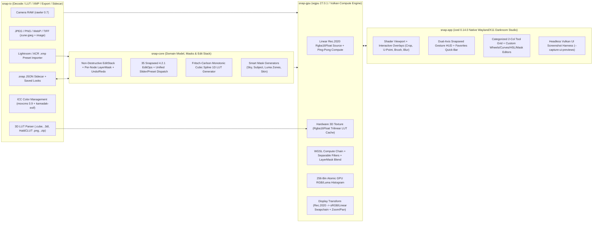
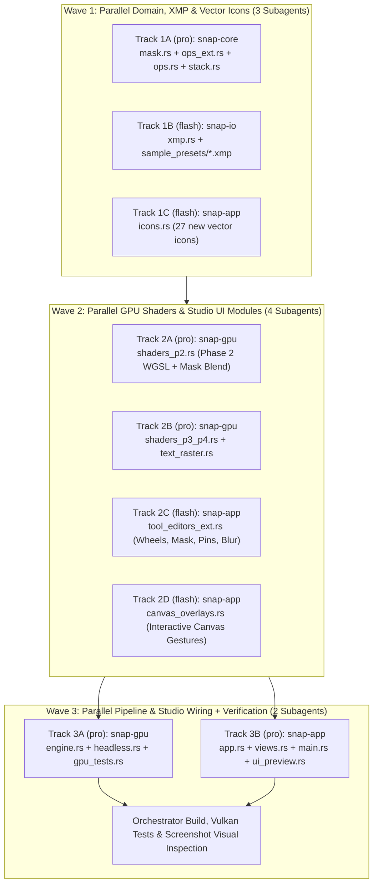

# Snap — Architecture, Feature Matrix & Phases 1–4 Implementation Plan

**Snap** is a fast, color-accurate, non-destructive native Linux photo editing and retouching studio inspired by **Snapseed v4.2.1** (`4.2.1.1014141696`), built with **Rust (2024 edition)**, **`iced 0.14.0`** (Wayland/X11 GUI), and **`wgpu 27.0.1`** (Vulkan compute & shader pipeline).

It combines Snapseed's zero-friction dual-axis canvas gesture workflow, Quick Looks, and 3D LUT / XMP preset import with a scene-referred 16/32-bit floating-point Linear Rec.2020 GPU pipeline, Oklab/Oklch perceptual color math, RAW support, and parametric edit stacks.

> **Companion Feature Catalog**: See [SNAPSEED_FEATURE_MATRIX.md](SNAPSEED_FEATURE_MATRIX.md) for the standalone 36-tool Snapseed 4.2.1 parity matrix.

---

## 1. Current Repository Status (Phases 1–4 Complete)

- **Completed**:
  - **Phase 1 Core MVP + Snapseed 4.2 LUT & Color Engine** (`snap-core`, `snap-io`, `snap-gpu`, `snap-app`, CLI export, `.desktop` packaging)
  - **Complete Darkroom Studio UI Overhaul** (`theme.rs`, 69-icon pure `iced::widget::canvas` vector engine in `icons.rs`, `stack!` HUD overlays, darkroom histogram & spline curves widgets, offscreen Vulkan UI screenshot harness `--capture-ui-previews <DIR>`, and multi-pass/HDR GPU bugfixes)
  - **Phases 2, 3, and 4 (100% Snapseed 4.2.1 Parity)**: All **35 `ToolId`s** covering all **36 Snapseed 4.2.1 tools**, per-layer `LayerMask` brush & 7 one-tap `SmartMaskKind`s in `View Edits`, Adobe Lightroom / ACR `.xmp` preset importer (`snap-io::xmp`), interactive viewport overlays (`canvas_overlays.rs`), pure-vector typography rasterizer (`text_raster.rs`), and headless GPU folder batch export (`--batch-dir`).
- **Test Status**: `64 / 64` workspace unit + live Vulkan GPU tests passing (`cargo test --workspace --offline`), `0` compiler warnings, `12 / 12` offscreen Vulkan `1440x900` UI previews verified.

---

## 2. System Architecture & Color Pipeline



### Key Color & Performance Design Choices
1. **Working Color Space**: Unclamped scene-referred **Linear Rec.2020 `Rgba16Float`** on the GPU, paired with **Oklab / Oklch** perceptual conversions for hue-preserving saturation, 8-band HSL, U-Point $\Delta E$ selectivity, and skin-tone isolation.
2. **Hardware Trilinear 3D LUTs**: Imported `.cube`, `.3dl`, and HaldCLUT `.png` LUTs upload once as `wgpu::TextureDimension::D3` (`Rgba16Float`) textures (`GpuLutCache`). Vulkan texture hardware performs trilinear interpolation + `0..100%` strength blending in `< 0.05 ms` per frame (`17^3`, `33^3`, `65^3`), transforming `Linear Rec.2020 -> LUT Input Space (sRGB / Rec.709 / Apple-Sony-Canon Log) -> 3D Sample -> Linear Rec.2020`.
3. **Swapchain Display Correctness**: `VIEWPORT_WGSL` converts `Linear Rec.2020 -> Linear sRGB` and branches on `surface_format.is_srgb()` so both `Bgra8UnormSrgb` (hardware sRGB encode) and non-sRGB surfaces display identical tone curves without double-gamma washout.

---

## 3. Completed Codebase Map (Phase 1 + Studio UI Overhaul)

- **`crates/snap-core/`** (`14` tests passing)
  - `src/color.rs` — Linear Rec.2020 <-> Linear sRGB / gamma sRGB / Oklab / Oklch matrices, Kelvin/Tint WB multipliers.
  - `src/curves.rs` — Fritsch–Carlson monotonic cubic Hermite splines -> `1024`-sample `f32` LUTs + 10 curve presets.
  - `src/ops.rs` — 10 Phase 1 `ToolId`s & `EditOp`s (`RawDevelop`, `WhiteBalance`, `TuneImage`, `Details`, `Curves`, `ColorHsl`, `Lut3d`, `BlackAndWhite`, `Vignette`, `CropRotate`) + auto-inscribed straighten bounds.
  - `src/stack.rs` — `EditStack`, `EditNode` (`id`, `enabled`, `opacity`, `op`), `HistoryManager<T>` (`100` steps), `ToolSessionHistory`.
  - `src/looks.rs` — Snapseed's 11 built-in `LookPreset`s (*Portrait, Smooth, Pop, Accentuate, Faded Glow, Morning, Bright, Fine Art, Push, Structure, Silhouette*) + custom Look serialization.
  - `src/config.rs` — XDG persistence (`~/.config/snap/config.json`, `~/.local/share/snap/{luts,looks}/`).
  - `src/image_types.rs` — `LinearImage`, `Lut3D` + CPU reference trilinear sampler, `HistogramData`.
- **`crates/snap-io/`** (`13` tests passing)
  - `src/decode.rs` — Fast JPEG (`zune-jpeg`), 8/16-bit PNG/TIFF/WebP (`image`), Camera RAW (`rawler`), ICC profiles (`moxcms`), EXIF orientation (`kamadak-exif`) -> `LinearImage` (Rec.2020).
  - `src/lut.rs` — `.cube`, `.3dl`, HaldCLUT `.png`, and `.zip` LUT pack importers + 6 built-in `33^3` procedural film LUTs.
  - `src/sidecar.rs` & `src/export.rs` — `.snap` JSON sidecars + full-res JPG / 8-bit & 16-bit PNG / 16-bit TIFF export with Lanczos3 resize (`Original`, `4000px`, `2048px`, `1080px`, `800px`).
- **`crates/snap-gpu/`** (`12` live Vulkan tests passing)
  - `src/engine.rs`, `src/shaders.rs`, `src/lut_cache.rs`, `src/headless.rs` — `GpuPipelineEngine` + `HeadlessGpu` on `wgpu 27.0.1` (`Rgba16Float` ping-pong compute passes, per-dispatch isolated uniform buffers & curve textures, 2-pass separable bilateral `Details`, 256-bin atomic histogram).
- **`crates/snap-app/`** (`5` tests + headless UI screenshot suite)
  - `src/theme.rs` — Darkroom Studio palette (`#0B0C0F` canvas, `#13151A` chrome, `#1B1E26` elevated cards, `#4F8EF7` accent blue, custom `studio_slider`, `thin_scrollable`, `studio_text_input`, `studio_checkbox`, `subtle_rule`, glass HUD styles).
  - `src/icons.rs` — Pure `iced::widget::canvas` geometric vector icon engine (`42` icons, zero font/emoji dependencies).
  - `src/views.rs`, `src/app.rs`, `src/canvas_shader.rs`, `src/curves_widget.rs`, `src/histogram_widget.rs`, `src/sample_scene.rs`, `src/ui_preview.rs`, `src/main.rs` — Full Welcome Studio, 48px Studio Top Bar + Favorites Quick-Bar, `stack!` canvas HUD overlays, Snapseed dual-axis swipe gesture HUD, View Edits stack inspector, CLI `--export`, and `--capture-ui-previews <DIR>`.

---

## 4. Critical Engineering, GPU & Subagent Invariants (MUST FOLLOW)

> **Read these 6 invariants before modifying any crate in Phases 2–4:**

1. **Offline Cargo in Sandbox**:
   - All dependencies are vendored/cached in `~/.cargo` and locked in `Cargo.lock`. Always pass `--offline` to Cargo (`cargo check --workspace --offline`, `cargo test --workspace --offline`, `cargo build --release --offline`).
2. **Zero-Tofu Pure-Vector UI (`icons.rs` Only, Strictly ASCII Text)**:
   - `iced` basic text shaping renders non-ASCII Unicode symbols/emojis (`★`, `✓`, `✕`, `⟲`, `◐`, etc.) as missing-glyph tofu boxes (`□`).
   - **Rule**: Every icon in Snap MUST be drawn geometrically in `crates/snap-app/src/icons.rs` (`Icon` enum + `canvas::Program`), and all UI strings must use clean ASCII text (`x`, `->`, `deg`, `%`, `EV`).
3. **Vulkan Multi-Pass Uniform Buffer Isolation (`wgpu` Ordering Hazard)**:
   - In `wgpu`, `queue.write_buffer(...)` executes on the queue timeline **before** `queue.submit([encoder.finish()])`. Writing twice to a shared uniform buffer inside one command encoder overwrites Pass 1's uniforms with Pass 2's values!
   - **Rule**: Inside `GpuPipelineEngine::process_stack`, allocate a fresh uniform buffer per dispatch via `device.create_buffer_init(...)` and push it into `temp_buffers: Vec<wgpu::Buffer>` kept alive until after `queue.submit(...)` (follow the existing pattern in `crates/snap-gpu/src/engine.rs`).
4. **HDR (`> 1.0`) Rec.2020 Headroom Preservation in WGSL Shaders**:
   - Photos and `sample_scene.rs` contain unclamped scene-referred HDR highlights (`1.0 .. 4.0+`).
   - Any shader converting to `[0, 1]` sRGB gamma or `[0, 1]` HSL MUST preserve linear headroom above `1.0` (e.g., `sample_curve(clamp(c, 0.0, 1.0)) + max(c - 1.0, 0.0)` or scaling normalized color by `hdr_scale = max(1.0, max(r, max(g, b)))`) so sun discs and specular highlights never solarize into dark gray holes.
   - *Exception*: Standard `.cube` 3D LUTs in `LUT_3D_WGSL` intentionally clamp to `[domain_min, domain_max]` per the Adobe `.cube` specification (`test_3d_lut_parity`).
5. **Headless Vulkan Visual Verification**:
   - `/dev/nvidia0` (Vulkan) is accessible directly inside the standard sandbox! Always verify UI layout and GPU visual output offscreen by running:
     ```bash
     cargo build --release --offline
     ./target/release/snap --capture-ui-previews /tmp/snap_previews
     ```
     and inspecting the rendered `1440x900` PNGs. (Only opening a live interactive Wayland window requires running outside the sandbox because `/run/user/1000/wayland-0` is isolated.)
6. **Parallel Subagent Orchestration Rules**:
   - `Workspace: "share"` / `"branch"` is unsupported here (`VCS type Unknown`); always spawn parallel subagents with **`Workspace: "inherit"`** and **strictly disjoint `.rs` file ownership** per wave.
   - Instruct parallel subagents **NOT** to run `cargo` concurrently (which contends on `target/.cargo-lock`) and **NOT** to call `read_file` on paths outside `/home/ashraf/Projects/Snap` (pass external crate signatures directly in their prompt if needed). Run `cargo check/test --workspace --offline` once in the orchestrator after all subagents in a wave return.

---

## 5. Complete Snapseed 4.2.1 Feature Matrix (35 `ToolId`s + Workflow Features)

### Workflow & Non-Destructive Stack Capabilities
| Capability | Status | Implementation Target |
| :--- | :---: | :--- |
| RAW + 8/16-bit Raster + ICC + EXIF Import/Export | `[x]` Done | `snap-io::{decode, export}` |
| 3D LUT Import (`.cube`, `.3dl`, HaldCLUT `.png`, `.zip`) | `[x]` Done | `snap-io::lut` + `snap-gpu::lut_cache` |
| Built-in 11 Looks + Save Custom Look + `.snap` Sidecar | `[x]` Done | `snap-core::looks` + `snap-io::sidecar` |
| Dual-Axis Canvas Swipe HUD + Favorites Quick-Bar + View Edits | `[x]` Done | `snap-app::{app, views}` |
| **Per-Layer Mask Brush** in `View Edits` (`0..100%`, Invert, Feather, Red Overlay) | `[x]` Done | `snap-core::mask::LayerMask` + `MASK_BLEND_WGSL` |
| **Smart Masking (4.0)** (1-tap *Sky, Subject, Background, Highlights, Midtones, Shadows, Skin*) | `[x]` Done | `snap-core::mask::SmartMaskKind` |
| **Adobe Lightroom / ACR `.xmp` Preset Import** | `[x]` Done | `snap-io::xmp` -> `LookPreset` |
| **Folder / CLI Batch Apply** (`--batch-dir <IN> <OUT> [--look\|--lut\|--xmp]`) | `[x]` Done | `snap-app::main` + `HeadlessGpu` |

### All 35 Editing & Retouching Tools (`ToolId`)
*(Note: Snapseed's Crop and Rotate share unified interactive geometry in `ToolId::CropRotate`, giving 35 `ToolId` variants covering all 36 Snapseed 4.2.1 tools.)*

| # | `ToolId` | Category | Status | Parameters & GPU Algorithm |
| :- | :--- | :--- | :---: | :--- |
| 1 | `RawDevelop` | Core & Color | `[x]` P1 | Exposure (`-8..+8 EV`), Highlights, Shadows, Contrast, Structure, Temp, Tint, Saturation |
| 2 | `TuneImage` | Core & Color | `[x]` P1 | Brightness, Contrast, Saturation, Ambiance, Highlights, Shadows, Warmth + Auto-Adjust |
| 3 | `Details` | Core & Color | `[x]` P1 | Separable edge-aware bilateral Structure (`-100..+100`), Sharpening (`0..100`) |
| 4 | `Curves` | Core & Color | `[x]` P1 | RGB / R / G / B / Luma monotonic splines + 10 presets |
| 5 | `WhiteBalance` | Core & Color | `[x]` P1 | Temp, Tint, Auto gray-world WB, Neutral Eyedropper |
| 6 | `ColorHsl` | Core & Color | `[x]` P1 | 8 color bands (*R, O, Y, G, C, B, P, M*) x Hue, Sat, Luma |
| 7 | `Lut3d` | Core & Color | `[x]` P1 | Hardware trilinear 3D LUT + Strength (`0..100%`) + Input Color Space |
| 8 | **`ColorGrade`** | Core & Color | `[x]` **P2** | 3-Way Oklab/Rec.2020 Color Wheels (*Shadows, Midtones, Highlights, Global*) x Hue, Sat, Luma + Balance (`-100..+100`) & Blending (`0..100`) |
| 9 | **`Dehaze`** | Core & Color | `[x]` **P2** | Atmospheric transmission recovery: Strength (`-100..+100`), WarmthOffset (`-100..+100`) |
| 10 | **`TonalContrast`** | Core & Color | `[x]` **P2** | Multi-band pyramid local contrast: High/Mid/Low Tones (`-100..+100`), Protect Shadows & Highlights (`0..100`) |
| 11 | `CropRotate` | Geometry | `[x]` P1 | Aspect presets, Straighten (`-45..+45 deg`) with auto-inscribed bounds, 90 deg CW/CCW, Flip H/V |
| 12 | **`Perspective`** | Geometry | `[x]` **P3** | Vertical/Horizontal Keystone (`-100..+100`), Rotate (`-45..+45`), Scale (`50..200%`), EdgeFill (`Black`, `White`, `SmartMirror`) via 3x3 inverse homography |
| 13 | **`Expand`** | Geometry | `[x]` **P3** | Top/Bottom/Left/Right margin (`0..25%`), `ExpandFillMode` (`Black`, `White`, `SmartEdge` mirrored patch synthesis) |
| 14 | **`Selective`** | Local & Retouch | `[x]` **P2** | Up to 16 Nik U-Point pins (`x, y, radius, brightness, contrast, saturation, structure`) weighted by GPU Oklab $\Delta E$ x smooth radial falloff |
| 15 | **`Brush`** | Local & Retouch | `[x]` **P2** | `BrushChannel` (`DodgeBurn`, `Exposure`, `Temperature`, `Saturation`), Step (`-1.0..+1.0`), Radius, Feather -> `256x256` signed map texture |
| 16 | **`Healing`** | Local & Retouch | `[x]` **P3** | `Vec<HealStroke>` (`x, y, radius, source_offset_opt`) -> multi-directional neighborhood patch synthesis & boundary feathering |
| 17 | `BlackAndWhite` | Film & Creative | `[x]` P1 | 6 optical filters (*Neutral, R, O, Y, G, B*), Brightness, Contrast, Grain |
| 18 | `Vignette` | Film & Creative | `[x]` P1 | Draggable center (`x, y`), Outer & Inner Brightness, Radius |
| 19 | **`Halation`** | Film & Creative | `[x]` **P2** | 2-pass separable highlight scatter into red/orange emulsion layer: Threshold (`0..100`), Strength (`0..100`), Spread (`0..100`) |
| 20 | **`Bloom`** | Film & Creative | `[x]` **P2** | 2-pass Pro-Mist soft highlight diffusion: Strength (`0..100`), Size (`0..100`), HighlightRange (`0..100`) |
| 21 | **`GrainyFilm`** | Film & Creative | `[x]` **P2** | 8 analog film stocks (*K100, K400, F200, Velvia50, Cinestill800T, IlfordHP5, CrossProcess, Polaroid*), Grain (`0..100`), StyleStrength (`0..100`) |
| 22 | **`Noir`** | Film & Creative | `[x]` **P2** | 4 presets (*Dark, Light, Film, Harsh*), Brightness, Contrast, Wash (matte lifted blacks `0..100`), Grain (`0..100`) |
| 23 | **`HdrScape`** | Film & Creative | `[x]` **P3** | 4 presets (*Nature, People, Fine, Strong*), FilterStrength (`0..100`), Brightness, Saturation via edge-preserving log-luminance compression |
| 24 | **`GlamourGlow`** | Film & Creative | `[x]` **P3** | Styles 1–5, Glow (`0..100`), Saturation (`-100..+100`), Warmth (`-100..+100`) via soft-light Gaussian blend |
| 25 | **`Drama`** | Film & Creative | `[x]` **P3** | 6 presets (*Drama 1/2, Bright 1/2, Dark 1/2*), FilterStrength (`0..100`), Saturation (`-100..+100`) |
| 26 | **`Vintage`** | Film & Creative | `[x]` **P3** | 12 color split-tone styles (`0..11`), Brightness, Saturation, StyleStrength, VignetteStrength, CenterSize |
| 27 | **`LensBlur`** | Blur & Optics | `[x]` **P3** | `Elliptical` / `Linear` tilt-shift (`center_x, center_y, inner_radius, transition, angle_deg`), BlurStrength (`0..100`), **BokehBoost** (`0..100` Vogel-disk specular blooming), VignetteStrength |
| 28 | **`MotionBlur`** | Blur & Optics | `[x]` **P3** | `FullScene` / `RadialPan` directional line-integral blur, Angle (`0..360 deg`), Strength (`0..100`), Center (`x, y`) |
| 29 | **`DoubleExposure`** | Film & Creative | `[x]` **P3** | Secondary image path/buffer + 6 blend modes (`Default`, `Lighten`, `Darken`, `Add`, `Subtract`, `Blend`) + Opacity (`0..100`) |
| 30 | **`Retrolux`** | Film & Creative | `[x]` **P4** | Styles `0..12`, Brightness, Saturation, Contrast, StyleStrength, Scratches (`0..100`), LightLeaks (`0..100`), deterministic Seed + Shuffle |
| 31 | **`Grunge`** | Film & Creative | `[x]` **P4** | Styles `0..4`, Brightness, Contrast, Saturation, TextureStrength (`0..100`), deterministic Seed + Shuffle (procedural FBM grunge overlay) |
| 32 | **`Portrait`** | Portrait & Finish | `[x]` **P4** | FaceCenter (`x, y`), FaceRadius, FaceSpotlight (`0..100`), SkinSmoothing (`0..100` Oklch skin-hue bilateral frequency separation), EyeClarity (`0..100`), SkinTone preset |
| 33 | **`HeadPose`** | Portrait & Finish | `[x]` **P4** | FaceCenter (`x, y`), YawX (`-100..+100`), PitchY (`-100..+100`), Smile (`-100..+100`), FocalLength (`-100..+100`) via smooth 2.5D radial/perspective warp |
| 34 | **`Frames`** | Portrait & Finish | `[x]` **P4** | 8 styles (`CleanWhite`, `MatteBlack`, `Polaroid`, `Film35mm`, `InstantDate`, `GalleryLine`, `RoughEdge`, `Letterbox`), Width (`0..100`), InnerLine (`bool`), AspectPad |
| 35 | **`TextOverlay`** | Portrait & Finish | `[x]` **P4** | Text string + Subtext, 8 badge/typography styles (`ModernBold`, `EditorialSerif`, `MinimalBox`, `StampFrame`, `CinemaSub`, `RetroBadge`, `VerticalTag`, `Signature`), Center (`x, y`), Scale, Opacity, InvertMask (knockout), ColorPreset |

---

## 6. Phases 2–4 Parallel Subagent Execution Blueprint (3 Waves)

To maximize build velocity and prevent merge/edit conflicts, execute Phases 2–4 in **3 strictly partitioned parallel waves**:



---

### Wave 1 — Foundation Domain Model, XMP Importer & Vector Icons (3 Parallel Subagents)

#### Track 1A (`pro`) — `crates/snap-core`
- **Owned Files**:
  - `crates/snap-core/src/mask.rs` *(new)*
  - `crates/snap-core/src/ops_ext.rs` *(new)*
  - `crates/snap-core/src/ops.rs`, `src/stack.rs`, `src/lib.rs`, `tests/core_tests.rs`
- **Deliverables**:
  1. `LayerMask` (`256x256` compact `u8` grid, serialized as hex/RLE in `.snap` JSON so sidecars remain compact + `#[serde(default)]` on `EditNode.mask: Option<LayerMask>` so Phase 1 `.snap` files load seamlessly):
     - `paint_dab(nx, ny, radius_norm, hardness, target_opacity)` & `paint_stroke(x0, y0, x1, y1, ...)`
     - `invert()`, `fill(u8)`, `clear()`, `sample_bilinear(u, v) -> f32`
     - `SmartMaskKind` (`Sky`, `SubjectCenter`, `Background`, `Highlights`, `Midtones`, `Shadows`, `SkinTones`) + `LayerMask::from_smart_mask(kind, &LinearImage) -> LayerMask` using Oklch luminance/chroma/hue + spatial priors + separable box-blur feathering.
  2. `ops_ext.rs` + `ops.rs`:
     - Add all 25 Phase 2–4 `ToolId` and `EditOp` variants + `ToolCategory` enum (`CoreColor`, `Geometry`, `LocalRetouch`, `FilmCreative`, `PortraitFinish`) so the Studio Tools panel renders clean section headers.
     - Implement `EditOp::default_for(ToolId)`, `is_neutral()`, `slider_params() -> Vec<(&'static str, f32, f32, f32)>`, and **`set_slider_param(index: usize, value: f32)`** so both Snapseed's vertical/horizontal canvas swipe HUD and desktop sliders automatically drive all 35 tools without giant boilerplate switches!
  3. Unit tests in `core_tests.rs` for `LayerMask` strokes/invert/bilinear/serde, all 7 `SmartMaskKind`s, and neutrality/roundtrip of all 35 `EditOp`s.

#### Track 1B (`flash`) — `crates/snap-io`
- **Owned Files**:
  - `crates/snap-io/src/xmp.rs` *(new)*
  - `crates/snap-io/src/lib.rs`, `tests/io_tests.rs`
  - `assets/sample_presets/cinema_kodak.xmp`, `assets/sample_presets/nordic_clean.xmp` *(new)*
- **Deliverables**:
  - Zero-new-dependency XML/RDF attribute & element parser (`import_xmp_preset(path) -> Result<LookPreset, IoError>` and `parse_xmp_str(xml, fallback_name)`).
  - Maps `crs:Exposure2012`, `Contrast2012`, `Highlights2012`, `Shadows2012`, `Whites2012`, `Blacks2012`, `Temperature`/`IncrementalTemperature`, `Tint`, `Vibrance`, `Saturation`, `Clarity2012`/`Texture`, `PostCropVignetteAmount`, `ConvertToGrayscale`, 8-band `HueAdjustment*` / `SaturationAdjustment*` / `LuminanceAdjustment*`, and `crs:ToneCurvePV2012*` into non-destructive `Snap` `EditNode`s (`RawDevelop`, `TuneImage`, `Details`, `ColorHsl`, `Curves`, `BlackAndWhite`, `Vignette`).

#### Track 1C (`flash`) — `crates/snap-app/src/icons.rs`
- **Owned Files**:
  - `crates/snap-app/src/icons.rs`
- **Deliverables**:
  - Add 27 crisp geometric `iced::widget::canvas` icons (`ColorGrade`, `Dehaze`, `TonalContrast`, `Perspective`, `Expand`, `Selective`, `Brush`, `Healing`, `Halation`, `Bloom`, `GrainyFilm`, `Noir`, `HdrScape`, `GlamourGlow`, `Drama`, `Vintage`, `LensBlur`, `MotionBlur`, `DoubleExposure`, `Retrolux`, `Grunge`, `Portrait`, `HeadPose`, `Frames`, `TextOverlay`, `Mask`, `Shuffle`).

*(Note: After Wave 1 returns, `snap-gpu` and `snap-app` will temporarily have non-exhaustive matches on the 25 new `ToolId`/`EditOp` variants until Wave 3 wires them; run `cargo test -p snap-core -p snap-io --offline` to verify Wave 1 immediately before launching Wave 2.)*

---

### Wave 2 — GPU Compute Shaders & Modular Studio UI Components (4 Parallel Subagents)

#### Track 2A (`pro`) — `crates/snap-gpu/src/shaders_p2.rs` *(new)*
- **Deliverables**:
  - `#[repr(C)]` `bytemuck::{Pod, Zeroable}` 16-byte-aligned uniform structs + WGSL `@compute @workgroup_size(16, 16)` shaders for all 9 Phase 2 tools + per-layer mask compositing:
    - `COLOR_GRADE_WGSL` (4-wheel Shadow/Mid/Highlight/Global Oklab/Rec.2020 tinting + luminance lift/gamma/gain + balance/blending)
    - `DEHAZE_WGSL` (atmospheric dark-channel local min transmission estimate + radiance recovery)
    - `TONAL_CONTRAST_WGSL` (multi-scale spatial detail extraction weighted into Low/Mid/High luma bands + shadow/highlight protection)
    - `HALATION_WGSL` (2-pass separable wide Gaussian highlight scatter tinted into red-orange film emulsion)
    - `BLOOM_WGSL` (2-pass separable Pro-Mist highlight glow screen-blended preserving HDR > `1.0`)
    - `GRAINY_FILM_WGSL` (8 film stock color matrices/tone curves + organic luminance-weighted halide grain)
    - `NOIR_WGSL` (dramatic silver-gelatin B&W contrast + matte black `wash` + film grain)
    - `SELECTIVE_WGSL` (16-pin uniform array, sampling anchor pixel at each pin's `(x, y)` to compute Oklab $\Delta E$ color similarity $\times$ smooth radial distance weight)
    - `BRUSH_WGSL` (samples `256x256` `R32Float` brush map texture for local Dodge/Burn, EV, Temp, or Sat)
    - `MASK_BLEND_WGSL` (`mix(pre_op_rgba, post_op_rgba, node_opacity * bilinear_mask(uv))`)

#### Track 2B (`pro`) — `crates/snap-gpu/src/shaders_p3_p4.rs` *(new)* & `crates/snap-gpu/src/text_raster.rs` *(new)*
- **Deliverables**:
  - Uniform structs + WGSL compute shaders for all 16 Phase 3 & Phase 4 tools:
    - `HEALING_WGSL` (iterates heal strokes inside radius, synthesizing texture-matched clean pixels from outside the blemish boundary with smooth edge feathering)
    - `PERSPECTIVE_WGSL` & `EXPAND_WGSL` (3x3 inverse homography + margin remap with `Black`, `White`, and `SmartMirror` texture synthesis)
    - `LENS_BLUR_WGSL` (32-tap Golden-Angle Vogel spiral disk kernel scaled by elliptical/linear tilt-shift focus map, weighting bright highlights by $1 + k \cdot \text{luma}^3$ for optical **Bokeh Boost** circles)
    - `MOTION_BLUR_WGSL` (directional / radial-pan 24-tap line integral blur)
    - `HDR_SCAPE_WGSL`, `GLAMOUR_GLOW_WGSL`, `DRAMA_WGSL`, `VINTAGE_WGSL`
    - `DOUBLE_EXPOSURE_WGSL` (bilinear-samples secondary `Rgba16Float` image texture with 6 blend modes)
    - `RETROLUX_WGSL` & `GRUNGE_WGSL` (deterministic hash-seeded procedural scratches, light leaks, matte vignette, and FBM grunge texture)
    - `PORTRAIT_WGSL` (Oklch skin-hue mask $\times$ face ellipse bilateral frequency-separation smoothing + spotlight vignette + local eye-clarity micro-contrast)
    - `HEAD_POSE_WGSL` (smooth 2.5D radial/perspective UV displacement for Yaw, Pitch, Smile curve, and Focal Length)
    - `FRAMES_WGSL` (8 gallery/Polaroid/35mm sprocketed film borders)
    - `TEXT_OVERLAY_WGSL` + `text_raster.rs` (crisp scalable stroke/Hershey vector font + 8 Snapseed badge layouts rasterized to `R8Unorm` mask texture and composited with normal or knockout-invert blending on GPU)

#### Track 2C (`flash`) — `crates/snap-app/src/tool_editors_ext.rs` *(new)*
- **Deliverables**:
  - Dedicated Studio inspector controls matching `theme.rs`:
    - Interactive **3-Way Color Grade Wheels** `canvas::Program` (clickable/draggable hue-saturation color discs for Shadows, Midtones, Highlights, Global + Luma sliders)
    - **Selective U-Point** pin list (Add Pin mode toggle, active pin pill selector, Delete Pin, B/C/S/Structure sliders)
    - **Brush & Healing** toolbars (channel selector pills, step/radius/feather sliders, Eraser, Clear strokes)
    - **Layer Mask Inspector** inside `View Edits` (Paint In / Erase, Brush Size & Hardness, Invert, Clear, Show Red Mask Overlay toggle, plus **7 one-tap Smart Mask pills**: *Sky, Subject, Background, Highlights, Midtones, Shadows, Skin*)
    - **Lens Blur**, **Double Exposure** (secondary image picker), **Retrolux / Grunge** (`Shuffle` seed button + style pills), **Frames**, and **Text Overlay** (`studio_text_input` + 8 badge style pills + Knockout toggle) panels.

#### Track 2D (`flash`) — `crates/snap-app/src/canvas_overlays.rs` *(new)*
- **Deliverables**:
  - Interactive viewport overlay `canvas::Program` layered cleanly over `CanvasShader` inside `views.rs`'s `stack!`:
    - Renders and drags **U-Point pins** (`B / C / S / St` badge + active radius circle)
    - Live **Brush / Healing / LayerMask** stroke painting on mouse press + drag, live feathered brush cursor ring, and optional translucent ruby-red mask preview overlay
    - Draggable focus/face/text center handles + radius rings for **Lens Blur**, **Motion Blur**, **Vignette**, **Portrait**, **Head Pose**, and **Text Overlay**.

---

### Wave 3 — Pipeline Integration, Batch CLI & Visual Verification (2 Parallel Subagents + Orchestrator Audit)

#### Track 3A (`pro`) — `crates/snap-gpu` Integration & Vulkan Tests
- **Owned Files**: `crates/snap-gpu/src/{lib.rs, engine.rs, headless.rs}`, `crates/snap-gpu/tests/gpu_tests.rs`
- **Deliverables**:
  - Register all 25 new compute pipelines in `GpuPipelineEngine::new`.
  - Support auxiliary GPU textures cached by content hash/revision (`256x256` `LayerMask`, `256x256` `Brush` map, `DoubleExposure` secondary `LinearImage`, `TextOverlay` rasterized glyph/badge texture).
  - Wrap any node in `process_stack` that has `node.mask.is_some()` or `node.opacity < 1.0`: snapshot pre-op texture -> run op(s) -> dispatch `MASK_BLEND_WGSL` using per-dispatch uniform buffers.
  - Add live Vulkan tests in `gpu_tests.rs` covering every Phase 2–4 shader, 2-pass `Halation`/`Bloom` uniform isolation, `LayerMask` 0%/50%/100% blending, and HDR > `1.0` highlight safety.

#### Track 3B (`pro`) — `crates/snap-app` Integration, XMP Import, Batch CLI & UI Previews
- **Owned Files**: `crates/snap-app/src/{lib.rs, app.rs, views.rs, main.rs, ui_preview.rs}`
- **Deliverables**:
  - Wire all 35 `ToolId`s into the categorized 2-column Studio Tools grid (`Core & Color`, `Geometry`, `Local & Retouch`, `Film & Creative`, `Portrait & Finish`) with star-pinning to the Favorites Quick-Bar.
  - Wire `Import .XMP Preset` in the Looks panel & file drag-and-drop alongside `.cube`/`.3dl`/`.png` LUTs.
  - Wire per-node `LayerMask` editing + Smart Mask generation inside `View Edits`.
  - Add headless GPU folder batch mode to `main.rs`:
    ```bash
    snap --batch-dir <INPUT_DIR> <OUTPUT_DIR> [--look <NAME_OR_SNAP>] [--lut <PATH>] [--xmp <PATH>] [--format jpg|png|tiff] [--quality 92]
    ```
  - Expand `ui_preview.rs` (`--capture-ui-previews <DIR>`) to capture screenshots of the categorized 35-tool grid, 3-Way Color Grade wheels, Selective U-Point + Layer Mask overlay, Lens Blur Bokeh Boost, and Frames/Text editors.

#### Final Orchestrator Verification Gate
1. `cargo test --workspace --offline` -> verify **all unit, XMP, Smart Mask, and live Vulkan GPU tests pass** with `0` warnings.
2. `cargo build --release --offline && ./target/release/snap --capture-ui-previews /tmp/snap_previews` -> visually inspect every rendered `1440x900` PNG screenshot to verify typography, alignment, zero tofu glyphs, custom controls, and clean HDR tone rendering.
3. Test `--batch-dir` CLI export on sample images + `.xmp` / `.cube` presets.

---

## 7. Quick-Start Prompt for Next Chat

Paste this into a new chat in `/home/ashraf/Projects/Snap` to resume immediately:

> Read `IMPLEMENTATION_PLAN.md` in the project root and proceed to build Phases 2–4 of Snap following the 3-Wave Parallel Subagent Execution Blueprint (respecting all Section 4 GPU/UI/offline invariants and verifying with `cargo test --workspace --offline` and `--capture-ui-previews`).
