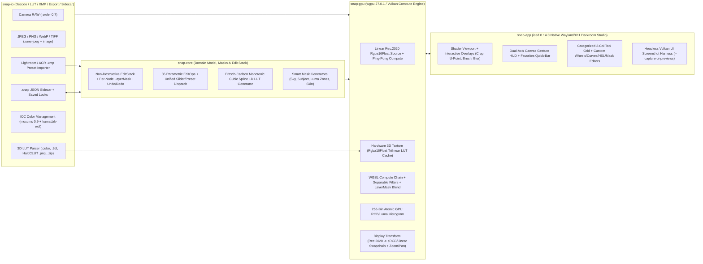

# Snap — Product Specification & System Architecture (`product_spec.md`)

**Snap** is a fast, color-accurate, non-destructive native Linux photo editing and retouching studio inspired by Snapseed, built with **Rust (2024 edition)**, **`iced 0.14.0`** (Wayland/X11 GUI), and **`wgpu 27.0.1`** (Vulkan compute & shader pipeline).

It combines a zero-friction dual-axis canvas gesture workflow, Quick Looks, and 3D LUT / XMP preset import with a scene-referred 16/32-bit floating-point Linear Rec.2020 GPU pipeline, Oklab/Oklch perceptual color math, RAW support, and parametric edit stacks.

---

## 1. Product Scope & Status Summary

- **Target Platform**: Native Linux desktop (Wayland & X11) + Headless Vulkan CLI.
- **Current Milestone Status (Phases 1–4 Complete)**:
  - **Phase 1 — Core MVP + LUT & Color Engine**: `snap-core`, `snap-io`, `snap-gpu`, `snap-app`, single-image CLI export, and `.desktop` packaging.
  - **Darkroom Studio UI Overhaul**: Custom palette (`theme.rs`), 69-icon pure `iced::widget::canvas` vector engine (`icons.rs`), `stack!` HUD overlays, darkroom histogram & spline curves widgets, and offscreen Vulkan UI screenshot harness (`--capture-ui-previews <DIR>`).
  - **Phases 2–4 — Complete Creative & Retouching Suite**: All **35 `ToolId`s**, per-layer `LayerMask` brush & 7 one-tap `SmartMaskKind`s in `View Edits`, Adobe Lightroom / ACR `.xmp` preset importer (`snap-io::xmp`), interactive viewport overlays (`canvas_overlays.rs`), pure-vector typography rasterizer (`text_raster.rs`), and headless GPU folder batch export (`--batch-dir`).
- **Verification Baseline**: `64 / 64` workspace unit + live Vulkan GPU tests passing (`cargo test --workspace --offline`), `0` compiler warnings, `12 / 12` offscreen Vulkan `1440x900` UI previews verified.

---

## 2. System Architecture & Color Pipeline



### Key Color & Performance Design Choices
1. **Working Color Space**: Unclamped scene-referred **Linear Rec.2020 `Rgba16Float`** on the GPU, paired with **Oklab / Oklch** perceptual conversions for hue-preserving saturation, 8-band HSL, U-Point $\Delta E$ selectivity, and skin-tone isolation.
2. **Hardware Trilinear 3D LUTs**: Imported `.cube`, `.3dl`, and HaldCLUT `.png` LUTs upload once as `wgpu::TextureDimension::D3` (`Rgba16Float`) textures (`GpuLutCache`). Vulkan texture hardware performs trilinear interpolation + `0..100%` strength blending in `< 0.05 ms` per frame (`17^3`, `33^3`, `65^3`), transforming `Linear Rec.2020 -> LUT Input Space (sRGB / Rec.709 / Apple-Sony-Canon Log) -> 3D Sample -> Linear Rec.2020`.
3. **Swapchain Display Correctness**: `VIEWPORT_WGSL` converts `Linear Rec.2020 -> Linear sRGB` and branches on `surface_format.is_srgb()` so both `Bgra8UnormSrgb` (hardware sRGB encode) and non-sRGB surfaces display identical tone curves without double-gamma washout.

---

## 3. LUTs, Presets, Workspace & Non-Destructive Workflow Spec

### 3.1 LUTs, Looks & Preset Engine
| Feature | Capabilities | Status | Implementation Details |
| :--- | :--- | :---: | :--- |
| **3D LUT Import & Tool** | Import `.cube`, `.3dl`, and `.png` (HaldCLUT); `0–100%` Strength slider; non-destructive stack layer | `[x]` Done | Hardware trilinear `wgpu::TextureDimension::D3` (`Rgba16Float`), supports arbitrary cube sizes (`17^3`, `33^3`, `65^3`), HaldCLUT `.png`, `.3dl`, `.cube`, `.zip` packs, plus **Input Color Space selector** (*sRGB, Rec.709, Apple/Sony/Canon Log*) |
| **Sidecar & LUT Pack Import** | Non-destructive stack recipes and `.zip` LUT bundles | `[x]` Done | `.snap` JSON non-destructive sidecar + `.zip` LUT bundle extraction into `~/.local/share/snap/luts/` |
| **Adobe `.xmp` Preset Import** | `.xmp` (Lightroom / Camera Raw develop profiles) | `[x]` Done | `snap-io::xmp` parametric importer mapping Exposure, Contrast, Highlights/Shadows, WB, Clarity, 8-band HSL, Vignette, B&W, and Tone Curves into `LookPreset` |
| **Built-in & Custom Looks** | 11 built-in Looks (*Portrait, Smooth, Pop, Accentuate, Faded Glow, Morning, Bright, Fine Art, Push, Structure, Silhouette*) + save any Edit Stack as a reusable Look | `[x]` Done | Stored cleanly in `~/.local/share/snap/looks/` with 1-click apply in the `Looks` tab |
| **Copy / Paste & Batch Recipes** | Copy edit stack from one photo and paste onto others / batch apply | `[x]` Done | `Copy` / `Paste` stack recipe + single-image `--export-cli` + `--batch-dir <IN> <OUT> [--look\|--lut\|--xmp]` GPU folder batch export |

### 3.2 Workspace, Navigation & Stack Capabilities
| Feature | Capabilities | Status | Implementation Details |
| :--- | :--- | :---: | :--- |
| **Dual-Axis Canvas Gesture** | Vertical drag = pick parameter HUD; Horizontal drag = adjust `-100..+100` | `[x]` Done | True `stack!` glass HUD overlays + right-sidebar studio sliders |
| **Hold to Compare** | Instant original image bypass preview | `[x]` Done | `Spacebar` hold + top-bar `Compare` toggle |
| **Customizable Favorites Bar** | Pin favorite tools (e.g., *Tune, LUT, Curves, Selective, Healing*) to top quick-access dock | `[x]` Done | Amber star pin on any tool card -> top Favorites Quick-Bar persisted in `~/.config/snap/config.json` |
| **In-Tool Undo / Redo** | Granular per-slider/node undo & redo inside an active tool session before committing to stack | `[x]` Done | `ToolSessionHistory` + global 100-step `HistoryManager<EditStack>` |
| **View Edits (History Stack)** | Inspect every applied step; toggle, delete, opacity-blend, or re-open & tweak earlier parameters | `[x]` Done | `View Edits` inspector with enable eye, opacity slider, edit, and delete |
| **Per-Layer Mask Brush** | Paint any edit step in/out (`0%, 25%, 50%, 75%, 100%`), invert mask, translucent red overlay | `[x]` Done | `256x256` feathered `LayerMask` per `EditNode` + GPU `MASK_BLEND_WGSL` + ruby-red canvas mask preview |
| **Smart Masking** | One-tap subject / sky / background isolation inside Edit Stack | `[x]` Done | 1-tap *Sky, Subject, Background, Highlights, Midtones, Shadows, Skin Tones* generators (`SmartMaskKind`) |
| **Live Histogram & Zoom Controls** | Real-time RGB/Luminance histogram + zoom/pan (`Fit`, `100%`, wheel zoom, middle-drag pan) | `[x]` Done | 256-bin atomic GPU histogram + darkroom instrument curve widget + `0.90` gallery mat fit |
| **Export & Sizing** | Save sidecar, Export JPG (`100%/95%/80%`), PNG, TIFF, resize (`Original`, `4000px`..`800px`), preserve EXIF & ICC | `[x]` Done | Full-res GPU export to JPG, 8/16-bit PNG, and 16-bit TIFF with Lanczos3 resize |

---

## 4. Complete 35-Tool Specification Matrix (`ToolId`)

### A. RAW & Core Tonal / Color Tools
| # | Tool (`ToolId`) | Sub-Parameters, Controls & GPU Algorithm | Status |
| :- | :--- | :--- | :---: |
| 1 | **RAW Develop** (`RawDevelop`) | Exposure (`-8..+8 EV`), Highlights, Shadows, Contrast, Structure, Temp, Tint, Saturation | `[x]` Done |
| 2 | **Tune Image** (`TuneImage`) | Brightness, Contrast, Saturation, Ambiance, Highlights, Shadows, Warmth (`-100..+100`) + Auto-Adjust Wand | `[x]` Done |
| 3 | **Details** (`Details`) | Separable edge-aware bilateral Structure (`-100..+100`), Sharpening (`0..100`) | `[x]` Done |
| 4 | **Curves** (`Curves`) | Channels (*RGB, Red, Green, Blue, Luminance*), Fritsch-Carlson monotonic cubic spline nodes + 10 presets (*Neutral, Hard/Soft Contrast, Brighten, Darken, High/Low Key, Fade, Punch, Cross Process*) | `[x]` Done |
| 5 | **White Balance** (`WhiteBalance`) | Temperature (`-100..+100`), Tint (`-100..+100`), Neutral Gray Eyedropper, Auto gray-world WB | `[x]` Done |
| 6 | **3D LUT** (`Lut3d`) | 6 built-in `33^3` film LUTs + user-imported `.cube` / `.3dl` / Hald `.png` / `.zip` library, Strength (`0..100%`), Input Color Space | `[x]` Done |
| 7 | **Color HSL** (`ColorHsl`) | 8 color bands (*Red, Orange, Yellow, Green, Cyan, Blue, Purple, Magenta*) x Hue, Saturation, Luminance (`-100..+100`) | `[x]` Done |
| 8 | **Color Grade** (`ColorGrade`) | 3-Way Oklab/Rec.2020 Color Wheels (*Shadows, Midtones, Highlights* + *Global*) x Hue, Sat, Luma + Balance (`-100..+100`) & Blending (`0..100`) | `[x]` Done |
| 9 | **Dehaze** (`Dehaze`) | Atmospheric dark-channel transmission recovery: Strength (`-100..+100`), Warmth Offset (`-100..+100`) | `[x]` Done |
| 10 | **Tonal Contrast** (`TonalContrast`) | Multi-band pyramid local contrast: High/Mid/Low Tones (`-100..+100`), Protect Shadows & Highlights (`0..100`) | `[x]` Done |

### B. Geometry & Canvas Tools
| # | Tool (`ToolId`) | Sub-Parameters, Controls & GPU Algorithm | Status |
| :- | :--- | :--- | :---: |
| 11 | **Crop & Rotate** (`CropRotate`) | Aspect presets (*Free, Original, 1:1, DIN, 3:2, 4:3, 5:4, 7:5, 16:9*), Straighten (`-45..+45 deg`) with auto-inscribed bounds, 90 deg CW/CCW, Flip H/V | `[x]` Done |
| 12 | **Perspective** (`Perspective`) | Vertical/Horizontal Keystone (`-100..+100`), Rotate (`-45..+45`), Scale (`50..200%`), EdgeFill (*Black, White, SmartMirror*) via 3x3 inverse homography | `[x]` Done |
| 13 | **Expand** (`Expand`) | Top/Bottom/Left/Right outward margin (`0..25%`), `ExpandFillMode` (*Black, White, SmartEdge* mirrored patch synthesis) | `[x]` Done |

### C. Local Adjustments & Retouching
| # | Tool (`ToolId`) | Sub-Parameters, Controls & GPU Algorithm | Status |
| :- | :--- | :--- | :---: |
| 14 | **Selective (U-Point)** (`Selective`) | Up to 16 control pins (`x, y, radius, brightness, contrast, saturation, structure`) weighted by GPU Oklab $\Delta E$ color similarity x smooth radial falloff | `[x]` Done |
| 15 | **Brush** (`Brush`) | `BrushChannel` (*Dodge & Burn, Exposure, Temperature, Saturation*), Step (`-1.0..+1.0`), Radius, Feather -> `256x256` signed `R32Float` map texture | `[x]` Done |
| 16 | **Healing** (`Healing`) | `Vec<HealStroke>` (`x, y, radius, source_offset_opt`) -> multi-directional neighborhood patch synthesis & boundary feathering | `[x]` Done |

### D. Cinematic, Analog, Blur & Creative Tools
| # | Tool (`ToolId`) | Sub-Parameters, Controls & GPU Algorithm | Status |
| :- | :--- | :--- | :---: |
| 17 | **Black & White** (`BlackAndWhite`) | 6 optical filters (*Neutral, Red, Orange, Yellow, Green, Blue*), Brightness, Contrast, Grain | `[x]` Done |
| 18 | **Vignette** (`Vignette`) | Draggable center (`x, y`), Outer & Inner Brightness, Radius | `[x]` Done |
| 19 | **Halation** (`Halation`) | 2-pass separable highlight scatter into red/orange emulsion layer: Threshold (`0..100`), Strength (`0..100`), Spread (`0..100`) | `[x]` Done |
| 20 | **Bloom** (`Bloom`) | 2-pass Pro-Mist soft highlight diffusion: Strength (`0..100`), Size (`0..100`), HighlightRange (`0..100`) | `[x]` Done |
| 21 | **Grainy Film** (`GrainyFilm`) | 8 analog film stocks (*K100, K400, F200, Velvia50, Cinestill800T, IlfordHP5, CrossProcess, Polaroid*), organic Halide Grain (`0..100`), StyleStrength (`0..100`) | `[x]` Done |
| 22 | **Noir** (`Noir`) | 4 silver-gelatin presets (*Dark, Light, Film, Harsh*), Brightness, Contrast, Wash (matte lifted blacks `0..100`), Grain (`0..100`) | `[x]` Done |
| 23 | **HDR Scape** (`HdrScape`) | 4 presets (*Nature, People, Fine, Strong*), FilterStrength (`0..100`), Brightness, Saturation via edge-preserving log-luminance compression | `[x]` Done |
| 24 | **Glamour Glow** (`GlamourGlow`) | Styles 1–5, Glow (`0..100`), Saturation (`-100..+100`), Warmth (`-100..+100`) via soft-light Gaussian blend | `[x]` Done |
| 25 | **Drama** (`Drama`) | 6 presets (*Drama 1/2, Bright 1/2, Dark 1/2*), FilterStrength (`0..100`), Saturation (`-100..+100`) | `[x]` Done |
| 26 | **Vintage** (`Vintage`) | 12 color split-tone styles (`0..11`), Brightness, Saturation, StyleStrength, VignetteStrength, CenterSize | `[x]` Done |
| 27 | **Lens Blur** (`LensBlur`) | `Elliptical` / `Linear` tilt-shift (`center_x, center_y, inner_radius, transition, angle_deg`), BlurStrength (`0..100`), **BokehBoost** (`0..100` 32-tap Vogel-disk specular blooming), VignetteStrength | `[x]` Done |
| 28 | **Motion Blur** (`MotionBlur`) | `FullScene` / `RadialPan` 24-tap directional line-integral blur, Angle (`0..360 deg`), Strength (`0..100`), Center (`x, y`) | `[x]` Done |
| 29 | **Double Exposure** (`DoubleExposure`) | Secondary image path/buffer + 6 blend modes (*Default, Lighten, Darken, Add, Subtract, Blend*) + Opacity (`0..100`) | `[x]` Done |
| 30 | **Retrolux** (`Retrolux`) | Styles `0..12`, Brightness, Saturation, Contrast, StyleStrength, Scratches (`0..100`), LightLeaks (`0..100`), deterministic Seed + Shuffle | `[x]` Done |
| 31 | **Grunge** (`Grunge`) | Styles `0..4`, Brightness, Contrast, Saturation, TextureStrength (`0..100`), deterministic Seed + Shuffle (procedural FBM grunge overlay) | `[x]` Done |

### E. Portrait & Finishing Tools
| # | Tool (`ToolId`) | Sub-Parameters, Controls & GPU Algorithm | Status |
| :- | :--- | :--- | :---: |
| 32 | **Portrait** (`Portrait`) | FaceCenter (`x, y`), FaceRadius, FaceSpotlight (`0..100`), SkinSmoothing (`0..100` Oklch skin-hue bilateral frequency separation), EyeClarity (`0..100`), SkinTone preset | `[x]` Done |
| 33 | **Head Pose** (`HeadPose`) | FaceCenter (`x, y`), YawX (`-100..+100`), PitchY (`-100..+100`), Smile (`-100..+100`), FocalLength (`-100..+100`) via smooth 2.5D radial/perspective warp | `[x]` Done |
| 34 | **Frames** (`Frames`) | 8 styles (*CleanWhite, MatteBlack, Polaroid, Film35mm, InstantDate, GalleryLine, RoughEdge, Letterbox*), Width (`0..100`), InnerLine (`bool`), AspectPad | `[x]` Done |
| 35 | **Text** (`TextOverlay`) | Text string + Subtext, 8 scalable vector typography/badge styles (*ModernBold, EditorialSerif, MinimalBox, StampFrame, CinemaSub, RetroBadge, VerticalTag, Signature*), Center (`x, y`), Scale, Opacity, InvertMask (knockout), ColorPreset | `[x]` Done |

---

## 5. Workspace Crate & Module Map

- **`crates/snap-core/`**
  - `src/color.rs` — Linear Rec.2020 <-> Linear sRGB / gamma sRGB / Oklab / Oklch matrices, Kelvin/Tint WB multipliers.
  - `src/curves.rs` — Fritsch–Carlson monotonic cubic Hermite splines -> `1024`-sample `f32` LUTs + 10 curve presets.
  - `src/ops.rs` & `src/ops_ext.rs` — All 35 `ToolId`s & `EditOp`s, `ToolCategory` grouping, `slider_params()`, and `set_slider_param()`.
  - `src/mask.rs` — `LayerMask` (`256x256` RLE-serialized mask grid, stroke/dab painting, bilinear sampling) + 7 `SmartMaskKind` generators.
  - `src/stack.rs` — `EditStack`, `EditNode` (`id`, `enabled`, `opacity`, `mask`, `op`), `HistoryManager<T>` (`100` steps), `ToolSessionHistory`.
  - `src/looks.rs` — 11 built-in `LookPreset`s + custom Look serialization.
  - `src/config.rs` — XDG persistence (`~/.config/snap/config.json`, `~/.local/share/snap/{luts,looks}/`).
  - `src/image_types.rs` — `LinearImage`, `Lut3D` + CPU reference trilinear sampler, `HistogramData`.
- **`crates/snap-io/`**
  - `src/decode.rs` — Fast JPEG (`zune-jpeg`), 8/16-bit PNG/TIFF/WebP (`image`), Camera RAW (`rawler`), ICC profiles (`moxcms`), EXIF orientation (`kamadak-exif`) -> `LinearImage` (Rec.2020).
  - `src/lut.rs` — `.cube`, `.3dl`, HaldCLUT `.png`, and `.zip` LUT pack importers + 6 built-in `33^3` procedural film LUTs.
  - `src/xmp.rs` — Zero-dependency Adobe Lightroom / Camera Raw `.xmp` preset parser -> non-destructive `LookPreset`.
  - `src/sidecar.rs` & `src/export.rs` — `.snap` JSON sidecars + full-res JPG / 8-bit & 16-bit PNG / 16-bit TIFF export with Lanczos3 resize.
- **`crates/snap-gpu/`**
  - `src/engine.rs`, `src/lut_cache.rs`, `src/headless.rs` — `GpuPipelineEngine` + `HeadlessGpu` on `wgpu 27.0.1` (`Rgba16Float` ping-pong compute passes, auxiliary mask/brush/secondary-image/text textures, atomic 256-bin histogram).
  - `src/shaders.rs`, `src/shaders_p2.rs`, `src/shaders_p3_p4.rs` — WGSL compute pipelines for all 35 tools + `MASK_BLEND_WGSL`.
  - `src/text_raster.rs` — Pure-Rust stroke/vector typography & badge rasterizer for `TextOverlay`.
- **`crates/snap-app/`**
  - `src/theme.rs` — Darkroom Studio palette (`#0B0C0F` canvas, `#13151A` chrome, `#1B1E26` elevated cards, `#4F8EF7` accent blue) and custom widget styles.
  - `src/icons.rs` — Pure `iced::widget::canvas` geometric vector icon engine (`69` icons, zero font/emoji dependencies).
  - `src/app.rs`, `src/views.rs`, `src/tool_editors_ext.rs`, `src/canvas_overlays.rs`, `src/canvas_shader.rs`, `src/curves_widget.rs`, `src/histogram_widget.rs`, `src/sample_scene.rs`, `src/ui_preview.rs`, `src/main.rs` — Full Darkroom Studio GUI, interactive overlays, 3-Way Color Grade wheels, Layer Mask inspector, CLI `--export-cli` / `--batch-dir`, and `--capture-ui-previews <DIR>`.

---

## 6. Critical Engineering & GPU Invariants

1. **Zero-Tofu Pure-Vector UI (`icons.rs` Only, Strictly ASCII Text)**:
   - `iced` basic text shaping renders non-ASCII Unicode symbols/emojis (`★`, `✓`, `✕`, `⟲`, `◐`, etc.) as missing-glyph tofu boxes (`□`).
   - **Rule**: Every icon in Snap MUST be drawn geometrically in `crates/snap-app/src/icons.rs` (`Icon` enum + `canvas::Program`), and all UI strings must use clean ASCII text (`x`, `->`, `deg`, `%`, `EV`).
2. **Vulkan Multi-Pass Uniform Buffer Isolation (`wgpu` Ordering Hazard)**:
   - In `wgpu`, `queue.write_buffer(...)` executes on the queue timeline **before** `queue.submit([encoder.finish()])`. Writing twice to a shared uniform buffer inside one command encoder overwrites Pass 1's uniforms with Pass 2's values.
   - **Rule**: Inside `GpuPipelineEngine::process_stack`, allocate a fresh uniform buffer per dispatch via `device.create_buffer_init(...)` and push it into `temp_buffers: Vec<wgpu::Buffer>` kept alive until after `queue.submit(...)`.
3. **HDR (`> 1.0`) Rec.2020 Headroom Preservation in WGSL Shaders**:
   - Photos and `sample_scene.rs` contain unclamped scene-referred HDR highlights (`1.0 .. 4.0+`).
   - Any shader converting to `[0, 1]` sRGB gamma or `[0, 1]` HSL MUST preserve linear headroom above `1.0` (e.g., `sample_curve(clamp(c, 0.0, 1.0)) + max(c - 1.0, 0.0)` or scaling normalized color by `hdr_scale = max(1.0, max(r, max(g, b)))`) so specular highlights never solarize into dark gray holes.
   - *Exception*: Standard `.cube` 3D LUTs in `LUT_3D_WGSL` intentionally clamp to `[domain_min, domain_max]` per the Adobe `.cube` specification (`test_3d_lut_parity`).
4. **Headless Vulkan Verification**:
   - Always verify both the test suite and rendered `1440x900` UI screenshots when modifying shaders or UI layouts:
     ```bash
     cargo test --workspace --offline
     cargo build --release --offline
     ./target/release/snap --capture-ui-previews /tmp/snap_previews
     ```
